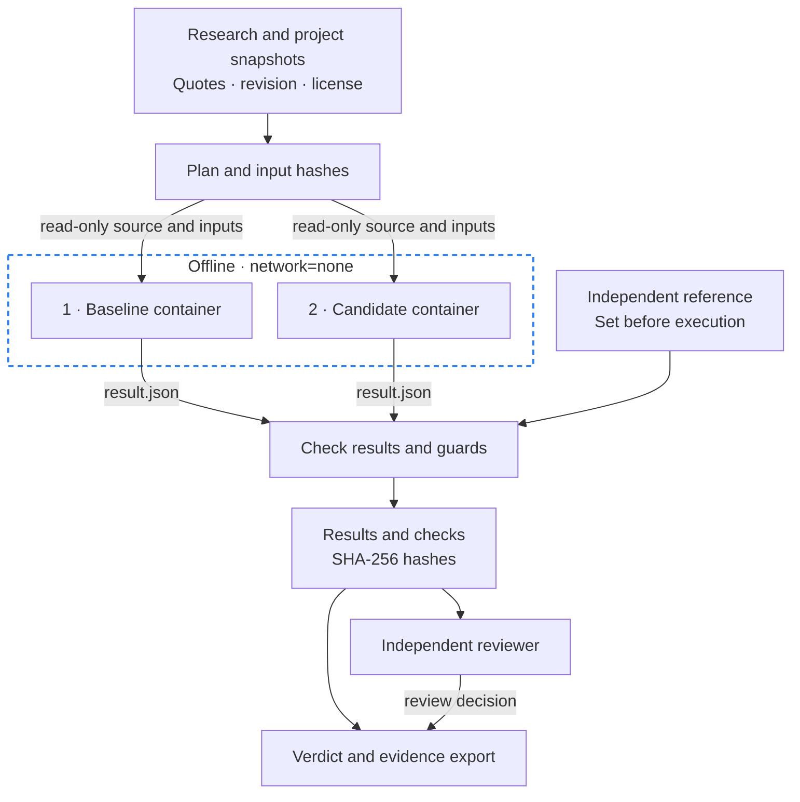

# DSH Paper2Project

English · [Русский](README_RU.md)


[](LICENSE)

> **Test a research claim against your project and get a verdict backed by evidence.**

[Quick start](#quick-start) · [CLI and MCP guide](docs/product/README.md) · [KVSET demo](examples/kvset-demo/run_demo.py)

## Architecture



Each variant runs in a fresh rootless Podman container with resource limits. The runner starts the baseline
first and the candidate second. The reference, scoring and review stay outside the containers.

## Quick start

Install from the repository root with Python 3.11 or newer:

```bash
python3 -m venv .venv
.venv/bin/python -m pip install .
.venv/bin/paper2project selftest
.venv/bin/paper2project doctor
```

The self-test runs locally without a model or Podman. For experiments, use Linux, rootless
Podman and a reviewed local image.

<details>
<summary>Example self-test result</summary>

The self-test reports `"status": "PASS"` when all seven checks pass. It checks source import,
rejects an invalid quotation and verifies that the default export omits raw project memory.

</details>

## Read the verdict

| Status | What the evidence supports | Next step |
| --- | --- | --- |
| ⚪ `ANALYSIS_ONLY` | The assessment cites the sources. No experiment is registered. | Prepare a plan and an independent reference. |
| 🔵 `NOT_APPLICABLE` | The method does not fit the selected task. | Close the hypothesis for this task. |
| 🔴 `EXPERIMENT_BLOCKED` / `EXPERIMENT_FAILED` | Execution was blocked or the experiment failed. | Inspect the report and run `doctor` if the environment is blocked. |
| 🟡 `REPRODUCED_BENEFIT_UNPROVEN` | The expected observations match. A benefit comparison is missing or a benefit criterion failed. | Identify the missing comparison or the failed criterion. |
| 🟣 `BENEFIT_PENDING_REVIEW` | The measured benefit meets the declared criteria. | Send the evidence to a separate reviewer. |
| 🟡 `BENEFIT_CRITERIA_MET` | The declared thresholds passed. | Verify the method, target data and frozen reference for each benefit experiment. |
| 🟢 `BENEFIT_DEMONSTRATED` | The comparison and independent review passed on the declared inputs. | Assess whether those inputs are representative before adopting the change. |

See [docs/product/README.md](docs/product/README.md) for the complete list of project statuses (including `NO_ANALYSIS`, `APPLICABILITY_PENDING_REVIEW`, `APPLICABILITY_CONFLICT`, `FINDINGS_PENDING_REVIEW`, `FINDINGS_REVIEWED`, `MIXED_EVIDENCE`, `STALE`, `STALE_EVIDENCE`, and `EXPERIMENT_INCOMPLETE`).

> [!TIP]
> Set acceptance criteria before running. A retry policy can reduce duplicates and still fail
> the benefit test if the no-loss guard rejects an increase in missed deliveries.

## Handling data and third-party code

> [!IMPORTANT]
> The workspace is local. Standalone model analysis sends selected project and research text
> to your configured endpoint only with explicit opt-in. Inspect evidence exports before sharing.

> [!CAUTION]
> Review third-party code and dependencies before execution. Mount only the data required
> by the experiment.

## Documentation

| Open | When to use it |
| --- | --- |
| [CLI and MCP guide](docs/product/README.md) | Configure a local workspace, import a PDF or register an experiment plan. |
| [KVSET demo](examples/kvset-demo/run_demo.py) | Try original author code on synthetic cache traces. |
| [Product scope](docs/product/PRODUCT.md) | Check supported workflows and their evidence limits. |
| [Release notes](docs/RELEASE-NOTES-1.0.2.md) | See changes in the current release. |
| [Original Paper2Agent adapter](https://github.com/Artemedi/dsh-paper2agent/blob/main/docs/USAGE.md) | Reproduce the earlier paper-processing workflow. |

[MIT license](LICENSE) · [Third-party notices](NOTICE.md) · [Original Paper2Agent MIT notice](licenses/Paper2Agent-MIT.txt)
