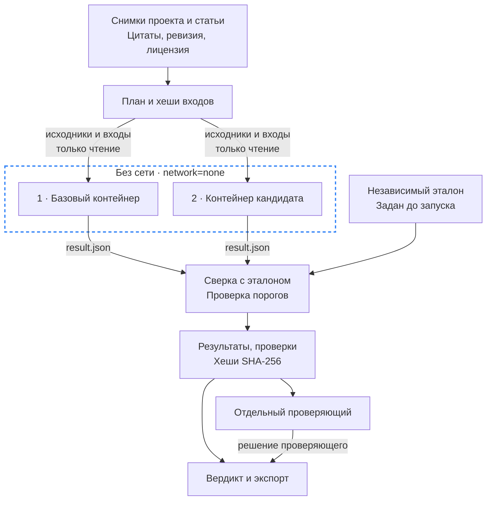

# DSH Paper2Project

[English](README.md) · Русский


[](LICENSE)

> **Проверьте тезис исследования на своём проекте и получите вердикт с доказательствами.**

[Быстрый старт](#быстрый-старт) · [Руководство по CLI и MCP](docs/product/README.md) · [Демо KVSET](examples/kvset-demo/run_demo.py)

## Архитектура



У каждого варианта отдельный контейнер rootless Podman с лимитами ресурсов. Раннер сначала выполняет
текущий подход, затем кандидат. Эталон, сверка результатов и независимая проверка
находятся за пределами контейнеров.

## Быстрый старт

Установите пакет из корня репозитория с Python 3.11 или новее:

```bash
python3 -m venv .venv
.venv/bin/python -m pip install .
.venv/bin/paper2project selftest
.venv/bin/paper2project doctor
```

Самопроверка выполняется локально, модель и Podman не нужны. Для экспериментов
понадобятся Linux, rootless Podman и проверенный локальный образ.

<details>
<summary>Пример результата самопроверки</summary>

При успешном прохождении семи проверок команда возвращает `"status": "PASS"`.
Она проверяет импорт источника, отклоняет неверную цитату и подтверждает, что
экспорт по умолчанию опускает исходные материалы проекта.

</details>

## Как читать вердикт

| Статус | Что подтверждено | Следующий шаг |
| --- | --- | --- |
| ⚪ `ANALYSIS_ONLY` | Оценка опирается на цитаты. Эксперимент ещё не зарегистрирован. | Подготовить план и независимый эталон. |
| 🔵 `NOT_APPLICABLE` | Метод не подходит выбранной задаче. | Закрыть гипотезу для этой задачи. |
| 🔴 `EXPERIMENT_BLOCKED` / `EXPERIMENT_FAILED` | Прогон заблокирован или эксперимент завершился неудачей. | Посмотреть отчёт. При проблеме со средой запустить `doctor`. |
| 🟡 `REPRODUCED_BENEFIT_UNPROVEN` | Ожидаемые наблюдения совпали. Сравнения пользы не было или критерий пользы провалился. | Уточнить, какого сравнения не хватает или какой порог нарушен. |
| 🟣 `BENEFIT_PENDING_REVIEW` | Измеренный эффект прошёл заявленные критерии. | Передать доказательства отдельному проверяющему. |
| 🟡 `BENEFIT_CRITERIA_MET` | Заявленные пороги пройдены. | Проверить метод, целевые данные и зафиксированный эталон каждого эксперимента. |
| 🟢 `BENEFIT_DEMONSTRATED` | Сравнение и независимая проверка прошли на заявленных данных. | Оценить, насколько эти данные представляют рабочие условия, прежде чем внедрять изменение. |

Полный список статусов проекта (включая `NO_ANALYSIS`, `APPLICABILITY_PENDING_REVIEW`, `APPLICABILITY_CONFLICT`, `FINDINGS_PENDING_REVIEW`, `FINDINGS_REVIEWED`, `MIXED_EVIDENCE`, `STALE`, `STALE_EVIDENCE` и `EXPERIMENT_INCOMPLETE`) см. в [docs/product/README.md](docs/product/README.md).

> [!TIP]
> Зафиксируйте критерии до запуска. Политика повторных отправок может сократить дубли
> и провалить проверку пользы, если выросло число пропусков, а критерий запрещает потери.

## Данные и сторонний код

> [!IMPORTANT]
> Рабочее пространство хранится локально. Модельный API получает выбранные тексты
> проекта и исследования только по явному разрешению. Просмотрите архив перед передачей.

> [!CAUTION]
> Проверяйте сторонний код и зависимости перед исполнением. Монтируйте в контейнер
> только данные, нужные для эксперимента.

## Документация

| Раздел | Когда открывать |
| --- | --- |
| [Руководство по CLI и MCP](docs/product/README.md) | Настроить рабочее пространство, импортировать PDF или зарегистрировать план. |
| [Демо KVSET](examples/kvset-demo/run_demo.py) | Запустить оригинальный код автора на синтетических трассах кеша. |
| [Границы продукта](docs/product/PRODUCT.md) | Уточнить поддерживаемые сценарии и границы доказательств. |
| [Заметки о выпуске](docs/RELEASE-NOTES-1.0.2.md) | Посмотреть изменения в текущей версии. |
| [Исходный адаптер Paper2Agent](https://github.com/Artemedi/dsh-paper2agent/blob/main/docs/USAGE.md) | Воспроизвести прежний конвейер обработки статей. |

[Лицензия MIT](LICENSE) · [Уведомления о сторонних материалах](NOTICE.md) · [Оригинальное уведомление MIT Paper2Agent](licenses/Paper2Agent-MIT.txt)
